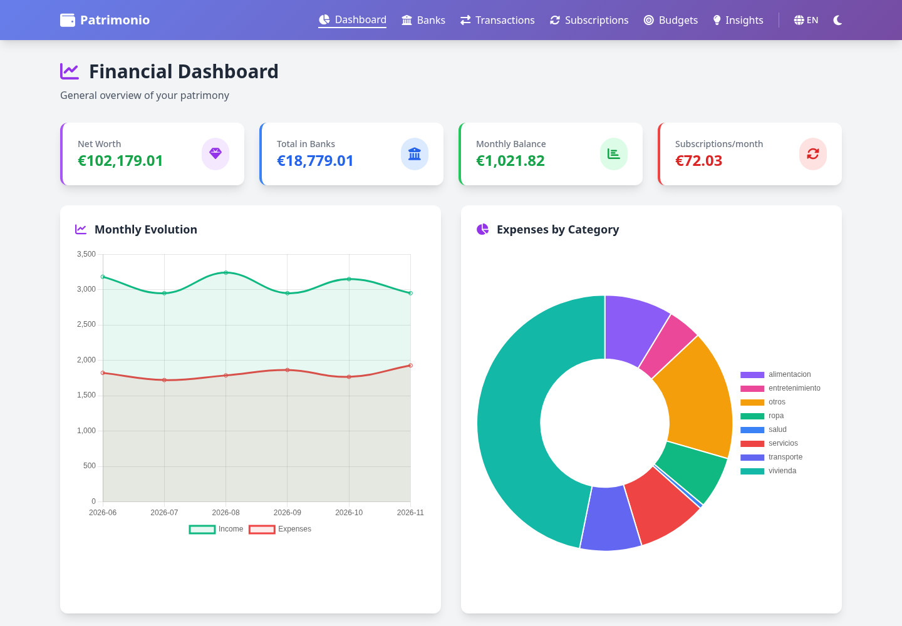
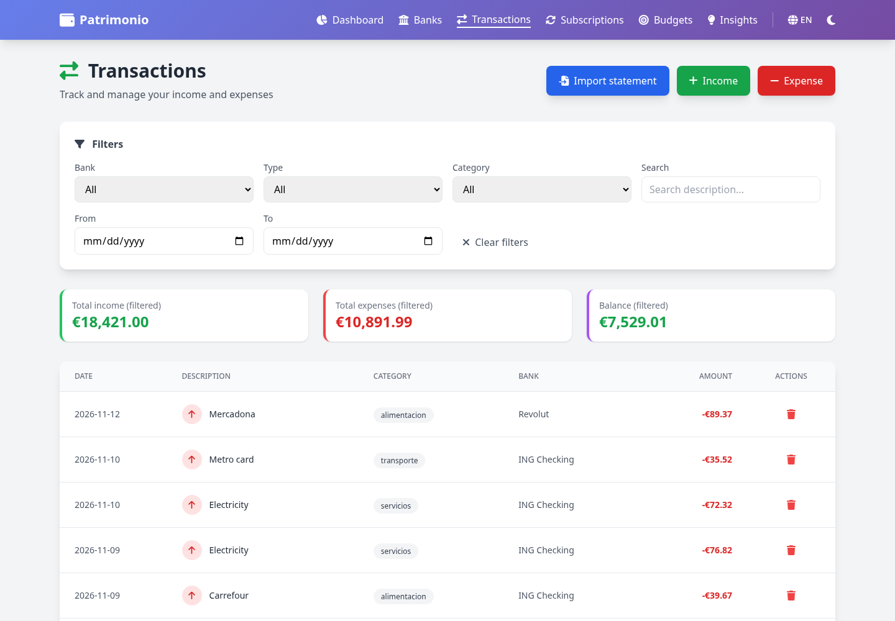
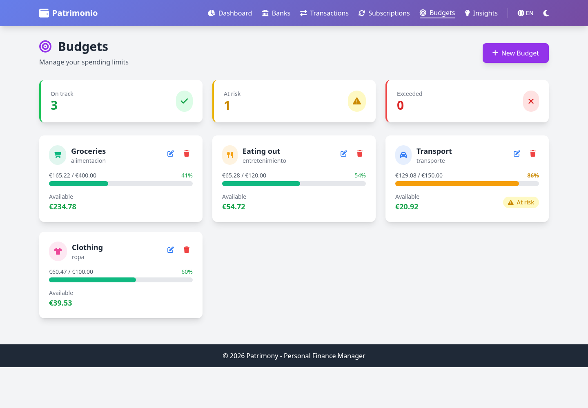

# FastFinance

[](https://github.com/Matzull/FastFinance/actions/workflows/ci.yml)


A self-hosted personal finance manager. Track bank accounts, income and expenses, subscriptions, budgets and net worth from a web dashboard, the command line, a Telegram bot that reads your receipts, or a Kivy mobile app.

Everything runs locally against a single SQLite file, so your financial data never leaves your machine.



## Features

- **Accounts and balances:** checking, savings and investment accounts, with balances computed from their transactions.
- **Income and expenses:** categorised transactions, with filters by account, type, category and date.
- **Bank statement import:** upload a CSV or XLSX export from your bank. Columns are detected automatically in English and Spanish, and rows that were already imported are skipped.
- **Subscriptions:** recurring charges (daily, weekly, monthly or yearly) normalised to a monthly cost.
- **Budgets:** monthly spending limits per category, flagged as on track, at risk or exceeded.
- **Net worth:** assets and liabilities plus account balances.
- **Insights:** savings rate, month-over-month spending changes, a projection for the current month and alerts.
- **Telegram bot:** check balances or log an expense by sending a photo of the receipt. OCR uses OpenAI Vision or local PaddleOCR.
- **Mobile app:** Kivy/KivyMD client for Android and desktop that talks to the same API.
- **REST API:** a documented FastAPI backend with interactive docs at `/docs`.

| Transactions | Budgets |
| --- | --- |
|  |  |

## Quick start

Requires Python 3.12+ and [uv](https://docs.astral.sh/uv/).

```bash
git clone https://github.com/Matzull/FastFinance.git
cd FastFinance
uv sync
uv run fastfinance-web
```

Open <http://127.0.0.1:8000>. The interactive API docs are at <http://127.0.0.1:8000/docs>.

Data is stored in `~/.patrimonio/patrimonio.db`, which is created on first run. Back up that file to back up everything.

To start the web server and the Telegram bot together, run `uv run python run.py` (Linux/macOS) or `.\run.ps1` (Windows).

## Configuration

Settings are read from environment variables or from a `.env` file in the project root. Copy `.env.example` to get started:

```bash
cp .env.example .env
```

| Variable | Default | Description |
| --- | --- | --- |
| `FASTFINANCE_HOST` | `127.0.0.1` | Address the web server binds to. Use `0.0.0.0` to reach it from other devices. |
| `FASTFINANCE_PORT` | `8000` | Web server port. |
| `FASTFINANCE_PASSWORD` | *(empty)* | If set, the web UI and the API require HTTP Basic auth with this password (any username). **Set it before exposing the server on your network.** |
| `FASTFINANCE_RELOAD` | `false` | Auto-reload on code changes (development only). |
| `TELEGRAM_BOT_TOKEN` | | Token from [@BotFather](https://t.me/BotFather). |
| `TELEGRAM_ALLOWED_USER_IDS` | | Comma-separated Telegram user IDs allowed to use the bot. Required; the bot will not start without it. |
| `OPENAI_API_KEY` | | Enables OpenAI Vision for receipt OCR. |

## Importing bank statements

On the **Transactions** page, click **Import statement** and choose the account and a `.csv` or `.xlsx` file. You can also call `POST /api/transactions/import-expenses` directly.

The importer matches column headers by name, ignoring case and accents:

| Field | Recognised headers (examples) |
| --- | --- |
| Date *(required)* | `date`, `booking date`, `fecha`, `fecha valor` |
| Description *(required)* | `description`, `concept`, `merchant`, `concepto`, `descripción` |
| Amount | `amount`, `importe`, `cantidad`. Negative values are treated as expenses. |
| Debit | `debit`, `withdrawal`, `cargo`, `debe` |
| Category | `category`, `categoría` |

Only expenses are imported. Each import tells you which columns it detected, and it reports any skipped rows, such as duplicates or invalid dates.

## Telegram bot

```bash
uv run fastfinance-bot
```

| Command | Description |
| --- | --- |
| *send a photo* | Read a receipt, review the extracted data and save it as an expense |
| `/gasto <amount> <description>` | Log an expense |
| `/ingreso <amount> <description>` | Log income |
| `/saldo` | Current balance of every account |
| `/resumen` | This month's income, expenses and subscriptions |
| `/gastos`, `/ingresos` | Recent expenses or income |
| `/suscripciones` | Active subscriptions and their monthly total |
| `/patrimonio` | Net worth breakdown |
| `/bancos` | List accounts |
| `/cancelar` | Cancel the current operation |

Receipt OCR uses OpenAI Vision when `OPENAI_API_KEY` is set. Otherwise it falls back to [PaddleOCR](https://github.com/PaddlePaddle/PaddleOCR), which is an optional, fairly large install:

```bash
uv sync --extra ocr
```

## Command line

```bash
uv run fastfinance --help

uv run fastfinance banco añadir --nombre "Main" --tipo corriente --saldo 1200
uv run fastfinance transaccion gasto --banco 1 --cantidad 54.20 --descripcion "Groceries" --categoria alimentacion
uv run fastfinance transaccion listar --limite 10
uv run fastfinance resumen
uv run fastfinance categorias
```

There are command groups for `banco`, `transaccion`, `suscripcion` and `patrimonio`, plus `resumen` and `categorias`.

## Mobile app

The mobile app is a client for the web server's API, so the server must be running and reachable from the device.

```bash
uv sync --extra mobile
uv run fastfinance-mobile
```

In the app's **Settings**, enter the server URL: `http://127.0.0.1:8000` on the same computer, or `http://<your-lan-ip>:8000` from a phone. For the phone case, start the server with `FASTFINANCE_HOST=0.0.0.0` and set `FASTFINANCE_PASSWORD`, then enter the same password in the app.

### Android build

`buildozer.spec` is included. Buildozer needs Java 17 to stay compatible with Gradle:

```bash
pip install buildozer cython
export JAVA_HOME=/usr/lib/jvm/java-17-openjdk-amd64
export PATH="$JAVA_HOME/bin:$PATH"
buildozer android debug
```

If you previously built with Java 21, stop the old Gradle daemons (`./gradlew --stop`) before retrying.

## Project structure

```text
src/patrimonio/
├── models.py       # SQLAlchemy models (accounts, transactions, subscriptions, budgets, net worth)
├── database.py     # Data access layer, statement import, insights
├── cli.py          # Typer CLI
├── web/            # FastAPI app, REST API, Pydantic schemas, Jinja2 + Alpine.js templates
├── bot/            # Channel-agnostic bot logic shared by the chat adapters
├── telegram/       # Telegram adapter and receipt OCR
├── whatsapp/       # WhatsApp (Twilio) adapter, experimental: no webhook server yet
└── mobile/         # Kivy/KivyMD client
tests/              # pytest suite
docs/               # Static demo page published to GitHub Pages
```

## Development

```bash
uv sync --dev
uv run pytest                    # run the test suite
uv run ruff check src tests      # lint
uv run ruff format src tests     # format
```

CI runs linting, the format check and the tests on every push and pull request to `main`.

A static demo page in `docs/` is deployed to GitHub Pages by `.github/workflows/deploy-pages.yml` on every push to `main`. To enable it, set **Settings → Pages → Source** to **GitHub Actions**.

## License

No license has been chosen yet. Until a `LICENSE` file is added, all rights are reserved by the author.
